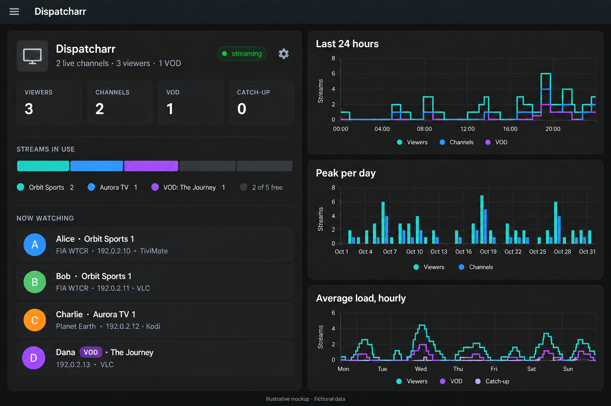

# Dispatcharr Info for Home Assistant

Home Assistant custom integration (HACS) that reads Dispatcharr stats over its REST API.

*Illustrative AI-generated mockup with fictional data; actual appearance depends on your Home Assistant theme and card settings.*

## Install

1. HACS -> Integrations -> three-dot menu -> Custom repositories -> add this repo's URL, category *Integration*.
2. Download "Dispatcharr Info" and restart Home Assistant.
3. Settings -> Devices & services -> Add integration -> *Dispatcharr Info*. Enter host, port (default 9191) and API key.

Manual install: copy `custom_components/dispatcharr_info` to `/config/custom_components/`.

The integration includes local brand icons in `custom_components/dispatcharr_info/brand/`.

## Repository topics

Recommended GitHub About topics: `home-assistant`, `hacs`, `custom-integration`,
`dispatcharr`, `iptv`, `monitoring`, and `python`.

## License

Licensed under the [MIT License](LICENSE).

## Auth
Personal API key sent as `X-API-Key`. The user must be admin: `/proxy/stats/` and
`/api/accounts/users/` are admin-only. Regenerate the key if it leaks.

## Sensors
All sensors are polled every 30 seconds and grouped under one "Dispatcharr" device.

| Sensor | Source | Meaning |
|---|---|---|
| EPG sources in error | `/api/epg/sources/` | active EPG sources with status error |
| Max streams | `/api/m3u/accounts/` | summed max streams of the active profiles of active M3U accounts (0 = unlimited, not counted); `accounts` attribute lists each profile |
| Active channels | `/proxy/stats/` | live channel count, `channels` attribute |
| Live viewers | `/proxy/stats/` | total clients on live channels |
| VOD connections | `/proxy/stats/` | VOD connections |
| Catch-up sessions | `/proxy/stats/` | catch-up sessions |
| Users | `/api/accounts/users/` | number of users; `users` attribute = usernames |
| Viewing sessions | stats + users + `/api/epg/current-programs/` | count; `sessions` attribute = user, channel, ip, player; live sessions also include `program` (title, start_time, end_time) when available |

Entity IDs follow the names, e.g. `sensor.dispatcharr_viewing_sessions`.

## Migrating from the YAML package
Remove `dispatcharr.yaml` from `/config/integrations/` (and the secret) before adding the
integration, otherwise the entity IDs clash. The old `Dispatcharr users` sensor
(`id=name;id=name` state) is replaced by `Users`: count as state, names as attribute.

## Dashboard
The integration bundles a dashboard: tiles for viewers, channels, VOD and catch-up, plus a
table of who is watching what. Restart HA after installing, then go to Settings -> Dashboards
-> Add dashboard -> Community dashboards -> *Dispatcharr* (HA 2026.5+). On older versions use a
dashboard with `strategy: {type: custom:dispatcharr}` in the raw configuration editor.
The script is added to the Lovelace resources automatically (to the index page if your
resources are managed in YAML). It uses built-in cards only.

The bundled `custom:dispatcharr-card` shows the current EPG programme below each live channel
in **Now watching**, followed on the same line by the viewer IP and client.
Programme times are not displayed.
EPG is queried only for active live channels every 30 seconds. Missing guide entries
or an unavailable EPG endpoint leave the existing viewing details intact; VOD and
catch-up sessions are not labelled with the live programme.

### Card settings

Administrators can click the cog on the generated Dispatcharr card to choose
what to display, then click **Save**. Choices are saved in the Home Assistant
dashboard and apply across browsers. **Cancel** leaves saved settings unchanged.
Individual cards provide the same controls through the visual card editor.

Controls include the header, summary, status, each metric box, streams in use,
now watching, avatars, user names, VOD/catch-up badges, channel/content title,
programme title, IP address, client name, and EPG error banner. You can also set
the title and maximum number of sessions. All sections remain visible by default;
programme times remain hidden.

YAML options are `show_header`, `show_summary`, `show_status`,
`show_live_viewers`, `show_active_channels`, `show_vod_connections`,
`show_catchup_sessions`, `show_streams`, `show_now_watching`, `show_avatars`,
`show_user`, `show_kind`, `show_channel`, `show_program`, `show_ip`, `show_client`,
and `show_epg_errors` (each `true` or `false`), plus `title` and `max_sessions`.
For generated dashboards, these are stored under `strategy.card_options`.

## Status
The `user_id` and `channel_name` fields in `/proxy/stats/` are confirmed in the Dispatcharr
source, but the integration has not been run against a live stream yet.
